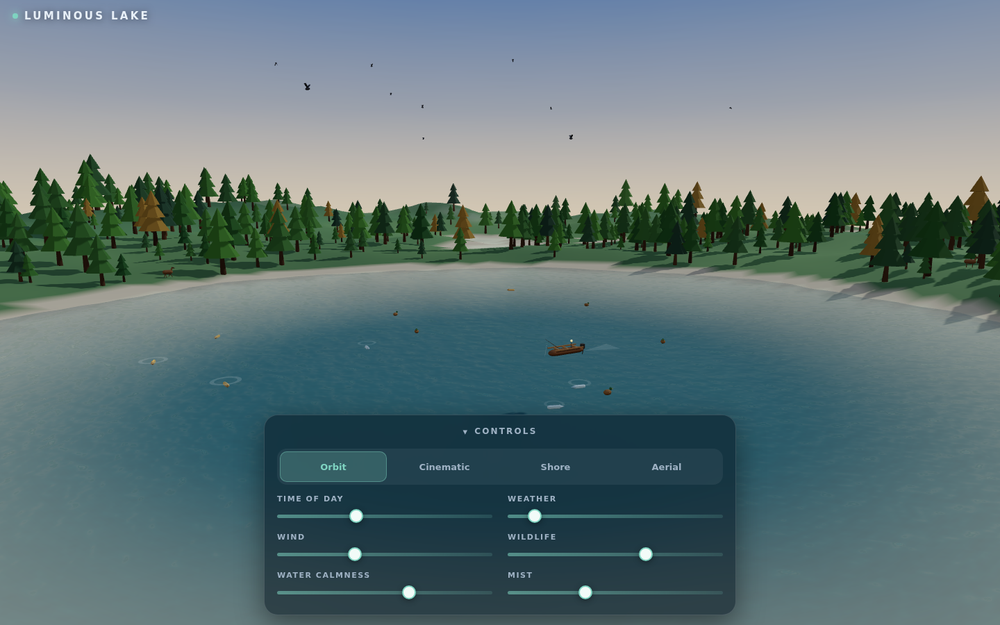
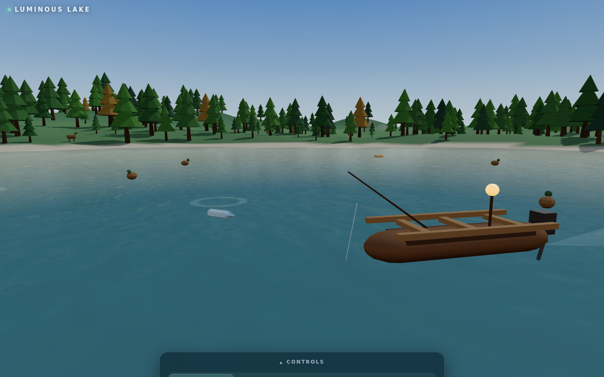
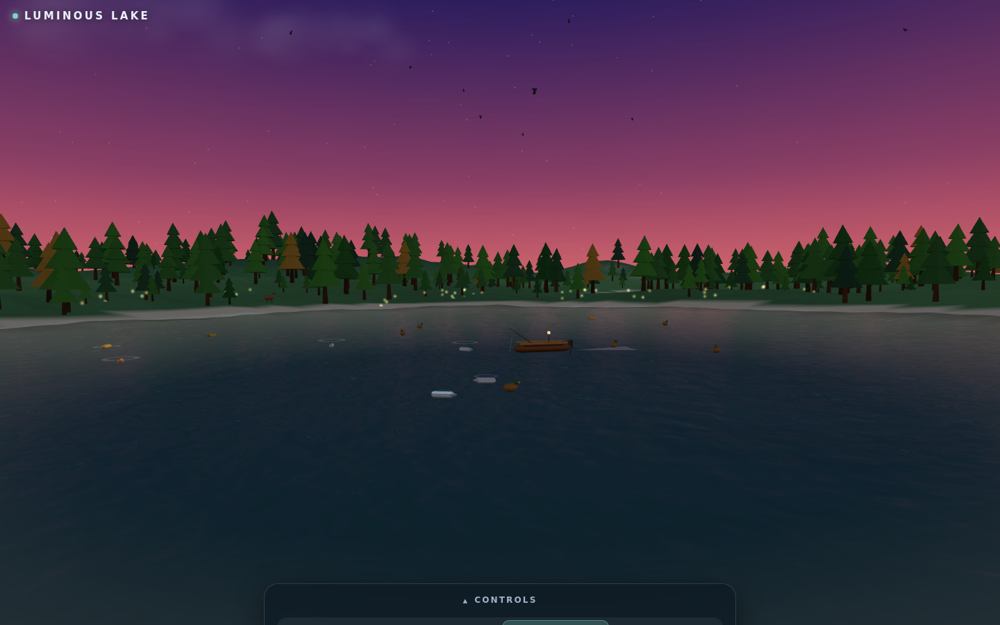

# Luminous Lake

A cinematic, fully procedural 3D lake world that runs in your browser — transparent
water you can see fish through, wind-driven waves, a drifting fishing boat, a living
forest, weather, and a full day/night cycle. No build assets, no textures, no models:
every tree, deer, duck, and ripple is generated in code.

**Live demo:** https://forest-lake.bles-software.com



Built with [Three.js](https://threejs.org) — WebGPU-first with an automatic WebGL
fallback, so it runs on practically any modern phone or desktop browser.

## What's inside

- **Transparent, living water** — physical material (clearcoat, IOR 1.333), CPU vertex
  waves, a dual-scroll procedural normal map, and live cube-camera reflections. Calm
  water turns to glass and reveals the depth-graded lakebed and the fish below;
  wind chops the surface up and makes it milkier, just like a real lake.
- **A small fishing boat** — wooden hull, benches, outboard motor, rod and line, a
  warm lantern at dusk, and a soft foam wake. It drifts around the lake and honestly
  pitches and rolls on the same wave field as the water.
- **Wildlife** — deer and foxes on the shore, birds overhead, ducks bobbing on the
  waves, and fish (silver + golden koi) cruising just under the surface with ripple
  rings — plus arc jumps with splashes, and fireflies at night.
- **Weather & time** — storm system with rain and lightning, mist banks at dawn,
  golden hour, and a star-lit night with a crisp moon reflection.
- **Touch-friendly controls** — time of day, weather, wind, wildlife density, water
  calmness, mist, and four cinematic camera modes (orbit, cinematic, shore, aerial).
- **Adaptive quality** — an FPS-driven scaler tunes reflections, shadows, pixel
  ratio, and particle counts so the world stays smooth on mid-range phones.




## Run it

```bash
npm install
npm run dev        # local dev server
npm run build      # production bundle in dist/
npm run check      # unit tests + lint + build
npm run validate   # the above + Playwright e2e (desktop & mobile)
```

Any static file server can host the production build — serve `dist/` and you're done.

## How it works

| Piece | Approach |
| --- | --- |
| Waves | One shared sum-of-sines field drives the water mesh, boat, ducks, and fish ripples — everything stays in sync |
| Water shading | `MeshPhysicalMaterial` + procedural canvas normal map + cube-camera reflections (gracefully disabled if unsupported) |
| Terrain | Seeded value-noise heightmap with a lake bowl, slope-aware vertex colors, depth-graded lakebed with caustic dappling |
| Sky | Procedural gradient dome + equirect environment map with a moving sun/moon |
| Animals | Pure simulation modules (deterministic RNG) feeding low-poly procedural meshes |
| Performance | Tiered quality scaler with an FPS meter; WebGPU preferred, WebGL fallback |

## License

MIT — see [LICENSE](LICENSE). Take it, fork it, build your own world on it.
